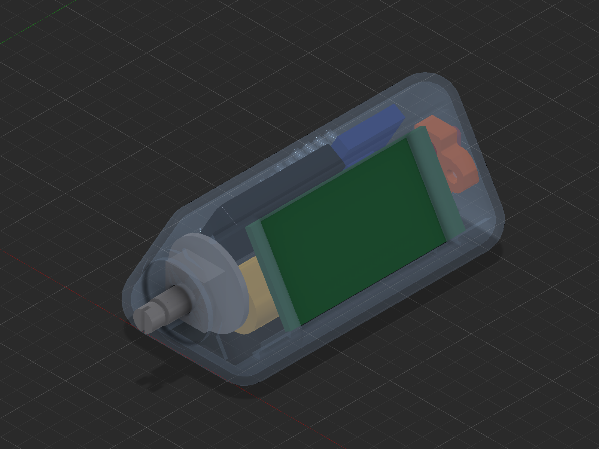

# Globo hardware

The enclosure, the parts inside it, and every print file made so far. You don't
need Fusion for any of this: everything current is here as STEP and STL too, and
opens in FreeCAD, CadQuery or anything else that reads those formats.

STEP holds the final shapes, not how they were built. The feature history and
sketches exist only in `cad/GloboTest.f3d`, which needs Fusion to open.



## Reading this as an LLM or a script

Start with [`index.json`](index.json). It lists every 3D file with its size,
position, volume and status, and says which parts are real and which are rough
stand-ins. All values are in mm.

| You want | Use |
|---|---|
| To see the layout | `model/renders/section_*.png`, labelled cross-sections |
| Where each part sits | `assembly` in `index.json` |
| Exact geometry to measure or modify | `model/bodies/<part>.step` |
| Fit checks, collisions, slicing | `model/bodies/<part>.stl` |
| The whole device as one model | `model/assembly.step`, with named parts |
| A quick look in the browser | `model/assembly.stl`, which GitHub shows in 3D |

Everything in `model/` shares one coordinate frame, so parts line up when loaded
together:

```python
import json, trimesh

index = json.load(open("hardware/index.json"))
parts = {p["part"]: trimesh.load(f"hardware/model/bodies/{p['part']}.stl")
         for p in index["assembly"]}
print(parts["enclosure"].bounds)          # [[92.56 -5 0] [135.13 80 39.02]]
```

```python
import cadquery as cq

device = cq.Assembly.importStep("hardware/model/assembly.step")
lid = cq.importers.importStep("hardware/model/bodies/lid.step")
```

## Coordinates

- **X** runs across the device.
- **Y** runs along it, from the knob end (y = -5) to the USB end (y = 80).
- **Z** points up, from the flat base with the lid opening (z = 0) to the ridge
  (z = 39).

## Parts

| Part | File in `model/bodies/` | How far to trust it |
|---|---|---|
| Enclosure | `enclosure` | Exact |
| TP4057 sokkel V6 | `tp4057_sokkel_v6` | Exact |
| Lid | `lid` | Exact shape, laid flat for printing |
| 5 knobs | `knob_*` | Exact shape, laid flat for printing |
| EC11 encoder | `encoder_ec11` | Modelled |
| 14500 battery | `battery_14500` | Modelled |
| 3525 speaker | `speaker_3525` | Modelled |
| MAX98357 amp | `amp_max98357` | Rough stand-in |
| LilyGo T-Display-S3 | `lilygo_board_placeholder` | Rough stand-in, a 53.9 × 25 × 2 slab |
| TP4057 charge board | `tp4057_board` | Rough stand-in |

The electronics are there to show position, not to serve as accurate models.

- **Stand-ins overlap.** The amp and battery share 240 mm³ in the model, and the
  TP4057 stand-in cuts into the sokkel. Neither happens in the real device.
- **The slide switch is missing.** The SS12F15 has no body in the design.
- **The lid has no assembled position.** It closes the opening in the base, but
  where it sits along Y isn't recorded. The opening is 3 mm longer than the lid.
- **The amp's name is inferred.** The design calls that body `Audio`.

For the full parts list and wiring, see [`../INVENTORY.md`](../INVENTORY.md).

## Folders

```text
hardware/
├── index.json        every 3D file, measured
├── model/            current design as STEP and STL, plus renders
├── cad/              Fusion files, and the script that builds the EC11 placeholder
├── print/            print files, by date
└── tools/            scripts that regenerate index.json and the sections
```

## Printing

`model/bodies/` holds the current design. Most parts print from there as they
are. The exception is the sokkel, which is in its assembled orientation, so use
a `PRINT_` file for that.

| Folder | What it is |
|---|---|
| `print/2026-10-29_tp4057_sokkel/` | Sokkel variants A to D and their casings: A, B and C use `casing_voor_A_B_C.stl`, D uses `casing_voor_D_oor_links.stl`. Generated by `source/variants.py`. |
| `print/2026-07-15_GloboTest_3Dprint/` | July set in STL, 3MF and STEP. |
| `print/archive/` | Older sets from May and June, including the first knob tests. |

The variants aren't in the Fusion design, which only has sokkel V6. The repo
doesn't record which sokkel is in the finished device.

`variants.py` is the record of how the variants were made, but it won't run as
is: it needs a `mod.pkl` that isn't included, and its paths point at the
machine it ran on.

Printing guidance from the first set (PLA, 0.2 mm layers, 15% infill, 3 walls)
is in `print/archive/2026-06-11_Globo_Print/README.txt`.

## Left out on purpose

**Third-party models.** These aren't ours to redistribute, so they aren't in
`model/`. Their bounds are in `index.json`, under `excluded_third_party`.

- The TP4057 board model ("Charging Module TP4057 Mini")
- The LilyGo T-Display-S3 models
- The EC11 knob by Pokzy, under a Standard Digital File License

`cad/GloboTest.f3d` still contains all three, because it's the unedited design.

**Files built from the TP4057 model.** `TP4057_echt_geplaatst.stl` and
`tp4057_sokkel_viewer.html` contain that same board, so they stay out too.

**Duplicates of the spiral knob.** Two 23 MB STLs were dropped. The July 3MF is
the same knob at a finer resolution, and STEP is the exact form.

## Updating

1. Save the design in Fusion, then export changed parts to `model/bodies/` as
   STEP and STL, keeping the file names.
2. Regenerate the index and sections:

   ```sh
   python3 hardware/tools/build_index.py        # standard library only
   python3 hardware/tools/render_sections.py    # pip install trimesh networkx matplotlib
   ```

`cad/GloboTest.f3d` is Fusion's local copy of version 60, saved 2 November 2026.
Replace it when the design moves on, and update `design` in
`tools/annotations.json`.
