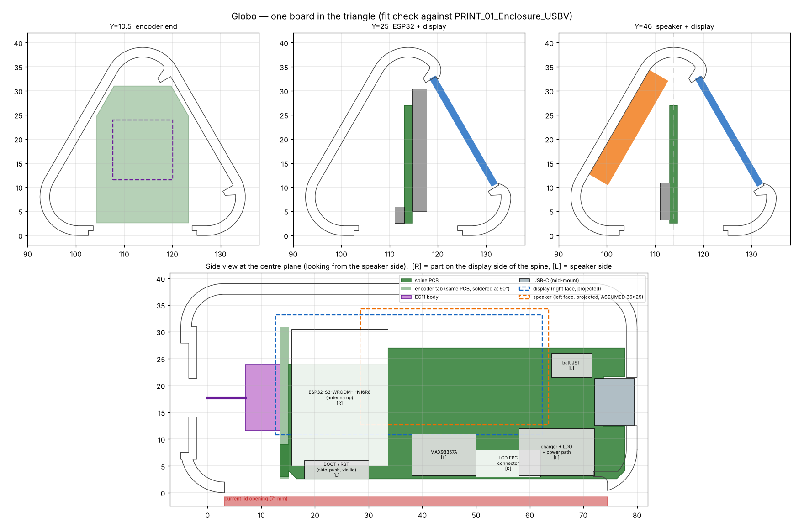

# Globo hardware: one board in the triangle

Today Globo is a T-Display-S3, a MAX98357 breakout, a KY-040 encoder and a
TP4057 charger module, wired together inside the printed triangle. This folder
plans their replacement: **one PCB** that carries everything, shaped for the
existing enclosure, with the **same GPIOs** so `globo_lcd.ino` runs on it
unchanged.

- `enclosure/`: the July test print (`GloboTest_3Dprint`), as STEP plus STL
  for the case and lid. The 23 MB knob STL is left out; the knob STEP is here.
- `pcb/globo_board.py`: every measured case dimension and every placement
  decision, in one script. Run it to get:
  - `pcb/fitcheck.png`: the board and parts drawn into real slices of the
    case STL.
  - `pcb/globo-board.kicad_pcb`: Edge.Cuts for the board, plus placement
    zones on F.Fab/B.Fab. Open it in KiCad and start the schematic from it.

## The enclosure, measured

All numbers come from slicing `PRINT_01_Enclosure_USBV.stl`.

| | |
|---|---|
| Shape | Equilateral triangular prism, 42.6 wide × 39 tall × 85 long, 2.1 mm walls, rounded corners |
| Inside | 80 mm long (Y −2…78). The triangle is 33 mm wide at the floor, with its apex at Z 36.7 |
| Left face | Speaker grille: 5 slanted slots, Y 38–54 |
| Right face | Display window, 45 × 26 mm (Y 15–60), with rails for the glass |
| Knob end | 7 mm hole on the centre axis (X 113.8, Z 17.7), inside a 20.4 mm recess for the knob |
| USB end | 3.5 × 9 mm upright slot on the centre axis (Z 12.5–21.5). It is sized for a USB-C shell standing on edge |
| Bottom | Lid opening 20.5 × 71.35 mm (Y 3.15–74.5), held by 4 snap clips |

## The idea: a spine

The knob hole and the USB slot are both on the prism's centre axis. A board
standing upright on that axis lines up with both:

- **The spine** is 1.6 mm thick, stands in the centre plane, and runs Y 15–78,
  Z 2.6–27.
  - **USB-C**: a *mid-mount* receptacle sits in a notch at the far edge of the
    spine. Its 8.94 × 3.26 shell lands exactly in the existing 3.5 × 9 slot.
  - **Display side [F]**: the ESP32-S3 module stands on end with its antenna
    pointing up, and the LCD's FPC connector sits low.
  - **Speaker side [B]**: the amp, the charger and LDO, the battery JST, and
    BOOT/RST switches on the bottom edge (reachable with the lid off).
- **The encoder tab** is a 19 × 28 mm piece shaped like a little house, cut
  from the same PCB order. A tongue on the spine fits into a slot in the tab,
  and the two are soldered at 90°, with pads across the joint so the encoder
  signals need no wires. The EC11 on the tab points its shaft at the knob
  hole. The tab is 19 mm wide, so it passes the 20.5 mm lid opening.
- **The display** is the bare 1.9" 170×320 ST7789 panel (25.8 × 49.7 ×
  1.43 mm, 8080 8-bit FPC). It is the same panel type as in the T-Display-S3.
  It sits in the window and its FPC folds onto the spine. At the worst point
  it clears the ESP32 module by 1.7 mm.

## Pin map: identical to the current firmware

This is the source of truth from `globo_lcd.ino` and `User_Setup.h`. The board
must keep these pins.

| Function | GPIO |
|---|---|
| LCD D0–D7 | 39, 40, 41, 42, 45, 46, 47, 48 |
| LCD CS / DC / RST / WR / RD | 6 / 7 / 5 / 8 / 9 |
| LCD backlight (PWM, through a transistor) | 38 |
| LCD power enable | 15 (keep it: a load switch for the LCD rail) |
| I2S BCLK / LRC / DOUT → MAX98357A | 11 / 12 / 10 |
| EC11 A / B / SW | 1 / 2 / 3 |
| Battery: VBAT/2 through a 100k/100k divider | 4 |
| USB D− / D+ (native USB-CDC, flashing) | 19 / 20 |
| BOOT | 0 |

Use the **ESP32-S3-WROOM-1-N16R8** (or N8R8). It has octal PSRAM like the
T-Display's S3R8, which reserves GPIO 35–37; none of those are in the map.
The firmware drives I2S on **11/12/10**. The top-level README still says
44/43/18; that is the old pin map.

## Parts

| Block | Part | Notes |
|---|---|---|
| MCU | ESP32-S3-WROOM-1-N16R8 | antenna up, overhanging a cut in the board (see the antenna note below) |
| Display | 1.9" 170×320 ST7789 IPS bare panel, 8080 FPC | e.g. BuyDisplay ER-TFT019-1; check the FPC pinout against the vendor drawing |
| Amp | MAX98357A (chip on board) | VDD from VSYS; tie SD_MODE high through 1 MΩ (left/right mix) |
| Encoder | EC11 **snap-in, no bushing**, shaft trimmed to 7 mm | see "Knob" below |
| USB-C | 16-pin **mid-mount** receptacle for a 1.6 mm board | 5.1 kΩ CC pull-downs |
| Charger | TP4057 (the chip you already use) or TP4054 | ~500 mA |
| Power path | P-MOSFET + Schottky load sharing | runs from USB with or without a cell |
| 3V3 | ≥600 mA LDO, low dropout (e.g. ME6211, AP2112K) | WiFi peaks plus the backlight |
| Battery | JST-SH 1.25 mm 2-pin | **size and spot are still open (see below)** |

## Changes the enclosure needs

`globo_board.py` checks the fit. Everything passes except one item:

1. **The lid opening must be lengthened from 71 mm to the full 80 mm (Y −2…78).**
   The board, from the encoder shaft tip to the USB face, is 79.5 mm long and
   has to drop in in one piece. Assembly: drop it in 1.5 mm short of the USB
   wall, slide it so the USB shell enters the slot, then close the lid. The
   lid then holds it in place: add two ribs on the lid that clamp the spine's
   bottom edge.
2. **Knob gets a stem.** The board can't be threaded onto the knob hole from
   inside, so the encoder shaft stops 2 mm inside the wall (Y 0). The knob
   gets a ~9 mm stem, 6.8 mm across, with a D-bore. The stem goes through
   the 7 mm hole and presses onto the shaft from outside. This needs no
   other change to the knob end.
3. The **TP4057 mount** (`PRINT_TP4057_Sokkel`) is no longer needed.

## Open questions

- **Battery.** Where does the 1200 mAh cell sit today, and what size is it?
  The fit check has no battery yet. Candidates:
  - Flat on the lid under the spine, if it is about 20 mm wide (e.g. a
    102050). The spine would then start above it.
  - One of the two low pockets either side of the spine, about 15 × 8 mm in
    cross-section and 60 mm long.
- **Speaker.** It is drawn as 35 × 25 × 4.5 against the left face (the "3525"
  from INVENTORY.md). The grille is only 16 mm long, so a smaller round driver
  may be what's really in there. If so, there is more room.
- **Antenna.** The module's antenna points into the apex. About two thirds of
  it is behind the LCD's FPC end. The T-Display-S3 lives with a similar
  arrangement. If range suffers, swap to the WROOM-1U and put a flex antenna
  in the apex.
- **Encoder height.** Pick the EC11 part number before routing the tab. Body
  heights differ between 6 and 7 mm, which moves the tab by that much.
  `ENC_BODY_H` in the script takes care of it.
